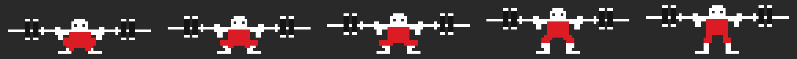
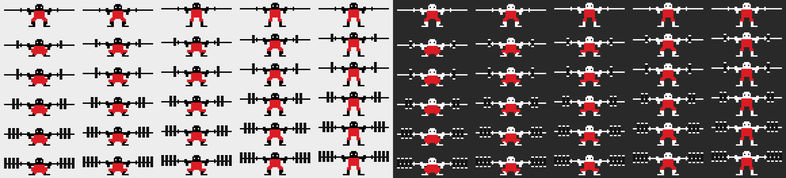

# MenuBarbell 🏋️

Un petit haltérophile en pixel art 8-bit qui fait des **squats dans la barre de menus de macOS**.
Plus ton Mac travaille, plus sa barre est chargée et plus il galère.



## Comment ça marche

L'app lit la charge du processeur chaque seconde et charge la barre en fonction :

| Charge CPU | Disques par côté | Rythme |
|---|---|---|
| < 8 % | barre vide | reps rapides (0,8 s) |
| 8 – 25 % | 1 petit | 0,9 s |
| 25 – 45 % | 1 gros | 1,2 s |
| 45 – 65 % | 2 gros | 1,6 s |
| 65 – 85 % | 3 gros | 2,2 s, la barre tremble |
| > 85 % | 4 gros | 3,2 s, la barre tremble |

Il fait toujours des reps complètes, avec une petite pause jambes tendues en haut.
Il s'adapte au thème clair ou sombre de la barre de menus. Un clic dessus affiche le pourcentage de charge et permet de quitter.



## Installation

Il faut macOS 12 ou plus récent et les outils de développement d'Apple (`xcode-select --install`).

```bash
git clone https://github.com/zregjbinz18U52309/menubarbell.git
cd menubarbell
./build.sh
```

`build.sh` compile l'app, l'installe dans `~/Applications/Squat.app`, la lance et active son démarrage automatique à l'ouverture de session.
Relance-le après chaque modification de `main.swift`.

## Suivre un autre Mac (justaucorps bleu)

```bash
./build.sh --mini            # suit l'hôte SSH « mini », affiché « Mac mini »
./build.sh --mini serveur "Mon serveur"
```

Installe `SquatMini.app` à côté de la version rouge : même haltérophile, en bleu, qui suit la charge d'un autre Mac.
Il lui faut un accès SSH sans mot de passe (clé, alias dans `~/.ssh/config`). Une seule connexion reste ouverte
(`iostat` toutes les 2 s sur le Mac distant). Mac injoignable : le bonhomme est grisé et le menu affiche « injoignable ».

## Désinstallation

```bash
launchctl bootout gui/$(id -u)/local.squat; rm ~/Library/LaunchAgents/local.squat.plist; rm -rf ~/Applications/Squat.app
# version bleue :
launchctl bootout gui/$(id -u)/local.squatmini; rm ~/Library/LaunchAgents/local.squatmini.plist; rm -rf ~/Applications/SquatMini.app
```

## Le code

Tout tient dans [`main.swift`](main.swift), sans dépendance : mesure du CPU, dessin pixel par pixel sur une grille de 52 × 18, animation à 20 images par seconde.
`./Squat --preview fichier.png` (l'exécutable dans `Squat.app/Contents/MacOS/`) génère la planche d'aperçu ci-dessus.

## Licence

MIT
